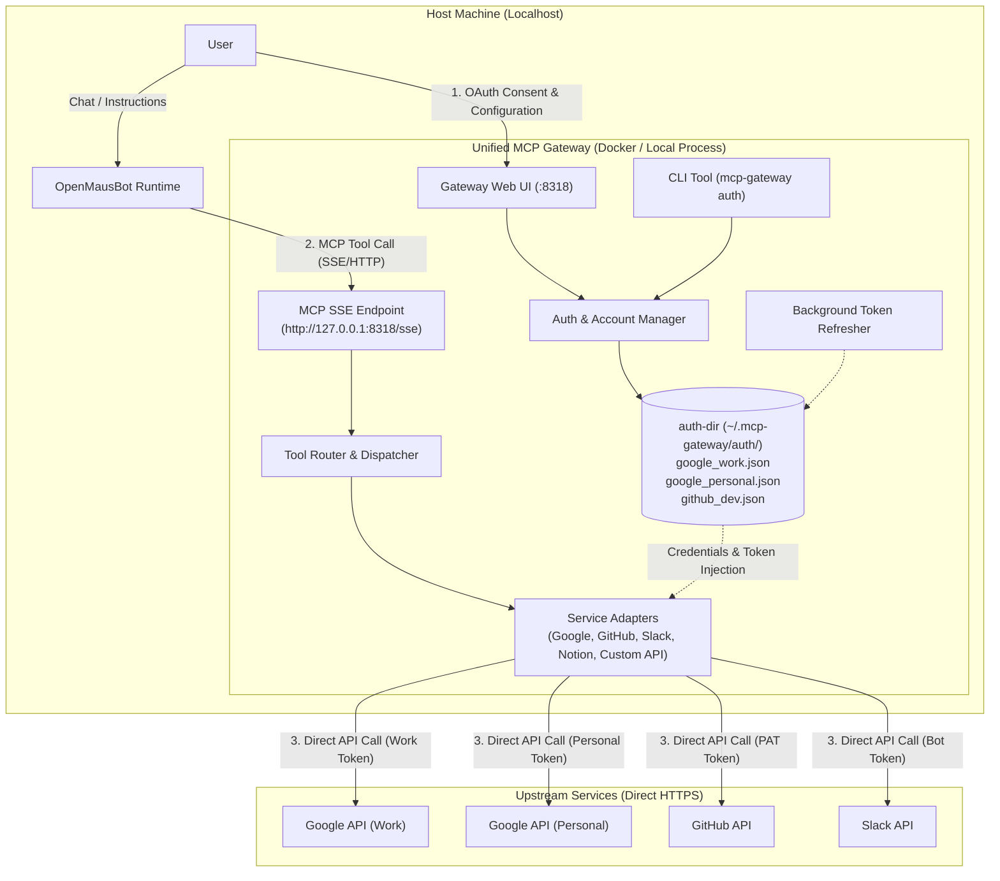

# Unified MCP Gateway Design: Direct Third-Party Integrations with Multi-Account Support

- **Date:** 2026-11-15
- **Status:** Approved
- **Scope:** Architectural (System Design & Integration Subsystem)

---

## 1. Problem Statement & Motivation

OpenMausBot currently provides two mechanisms for third-party service integration:
1. **Connected Apps via Composio:** Relies on external broker/cloud servers (`cloudflare/composio-broker` and `api.composio.dev`), routing sensitive user tokens and private data through third-party infrastructure.
2. **Built-in MCP Client:** Already supports Model Context Protocol (MCP) servers locally via `stdio` subprocesses and remotely via `HTTP/SSE`.

### Goal
Eliminate external broker dependency by introducing a **Self-Hosted Unified MCP Gateway**. This gateway runs locally alongside OpenMausBot, manages direct OAuth2/API credentials for multiple accounts per provider (inspired by `cliproxyapi` / `9router`), and exposes tools directly to OpenMausBot via the native MCP interface.

Zero bytes of user data or authentication tokens pass through third-party intermediaries.

---

## 2. Architecture & Components

### Component Breakdown
1. **Auth & Account Manager (Multi-Account Engine):**
   - **`auth-dir` Storage:** Persists independent credentials per account file: `<provider>_<alias>.json` (e.g., `google_work.json`, `google_personal.json`).
   - **Dual Authorization Interfaces:**
     - **Web Management Dashboard (`http://127.0.0.1:8318`):** Local web UI to inspect accounts, view connection health, and initiate OAuth2 consent redirects.
     - **CLI Runner:** Quick command-line execution (`mcp-gateway auth <provider> --alias <name>`) for headless environments.
   - **Background Token Refresher:** Periodically inspects token expiration and automatically exchanges refresh tokens before expiration.
2. **Tool Router & Dynamic Tool Registry:**
   - Detects all `ACTIVE` accounts in `auth-dir`.
   - Namespaces tools by account alias: `<provider>__<alias>__<action>` (e.g., `google__work__gmail_send_mail`, `google__personal__gmail_send_mail`).
   - Dynamically registers tool schemas to the MCP protocol endpoint.
3. **Service Adapters:**
   - **Google Workspace Adapter:** Gmail, Google Calendar, Google Drive/Docs (OAuth2).
   - **GitHub Adapter:** Repos, Pull Requests, Issues, Commits (PAT / OAuth).
   - **Slack Adapter:** Channels, Messages, Search (OAuth / Bot Token).
   - **Notion Adapter:** Pages, Databases, Search (API Key / OAuth).
   - **Custom REST Adapter:** Loads YAML/JSON specs to map arbitrary internal company APIs into MCP tools.
4. **OpenMausBot MCP Integration:**
   - Connects to the gateway as a standard Remote MCP server (`server/mcp-registry.ts`) via `http://127.0.0.1:8318/sse`.
   - Requires zero modifications to core agent drivers or LLM runtime.

---

## 3. Multi-Account Management & Routing Strategy

Unlike LLM load-balancing proxies where requests can be routed round-robin across accounts, tool actions (sending emails, modifying repositories, posting messages) have strict identity requirements.

### Routing Rules
1. **Explicit Account Aliasing:**
   - Every account must specify a unique alias upon authorization (e.g., `work`, `personal`, `client-a`).
   - Tool names explicitly encode the alias: `<service>__<alias>__<tool_name>`.
2. **Agent Context Guidance:**
   - Tool descriptions clearly state the target account: *"Sends an email using Google Workspace account 'work' (user@company.com)"*.
   - Models naturally select the matching tool when user prompts specify context ("send from my work email").
3. **Disambiguation Fallback:**
   - If user instructions are ambiguous and multiple accounts exist for the service, the agent prompts the user for clarification before executing.

---

## 4. Security & Isolation Invariants

1. **Localhost Binding:**
   - All gateway endpoints (`:8318`) bind exclusively to `127.0.0.1`.
2. **Internal Secret Protection:**
   - Gateway enforces an internal bearer token (`GATEWAY_INTERNAL_KEY`) generated on initialization. OpenMausBot sends this key via authorization headers.
3. **Storage Security:**
   - Files in `auth-dir` are restricted to file permissions `0600` (read/write only by owner).
   - Optional AES-256 encryption at rest for token files.
4. **Isolated Testing Fixtures:**
   - Following `AGENTS.md` and `docs/verification/README.md`, all tests run against mock endpoints / isolated fixtures without touching real credentials or live accounts.

---

## 5. Error Handling & Recovery

| Failure Mode | Gateway Behavior | Client/Bot Presentation |
| :--- | :--- | :--- |
| **Token Expired / Refresh Failed** | Returns standard MCP error with code `auth_required` and provider/alias details. | Bot informs user: *"Token for 'google:work' has expired or was revoked. Please re-authenticate at http://localhost:8318 or via CLI."* |
| **Upstream Rate Limit (429)** | Exponential backoff retry (up to 3 attempts). | If still failing, returns rate-limit error with `Retry-After` estimation. |
| **Upstream 5xx Outage** | Traps error and formats actionable diagnostic message. | Bot reports upstream service degradation without crashing the conversation loop. |
| **Invalid Parameters** | Schema validation via Zod before upstream dispatch. | Immediate 400 error with descriptive parameter fix. |

---

## 6. Implementation & Rollout Phases

### Phase 1: Core Gateway, Multi-Account Auth & Initial Adapters (Google & GitHub)
- Scaffold Gateway project (Node.js/TypeScript or Go, packaged with Dockerfile).
- Implement `auth-dir` storage manager with token refresh background daemon.
- Implement Local Web UI (:8318) and CLI authentication runner.
- Implement Google Workspace Adapter (Gmail, Calendar, Drive) and GitHub Adapter.
- Mount Gateway as Remote MCP server in OpenMausBot and verify direct tool execution.

### Phase 2: Slack, Notion & Custom REST API Adapter
- Implement Slack Adapter (Channels, Messages) and Notion Adapter.
- Implement `custom-apis.yaml` declarative parser for internal corporate REST APIs.
- Unit and integration tests for dynamic schema generation.

### Phase 3: OpenMausBot UX & Quick Templates
- Add UI presets/templates in OpenMausBot Settings to connect to Local Gateway with 1 click.
- Documentation for running via Docker Compose alongside OpenMausBot.
