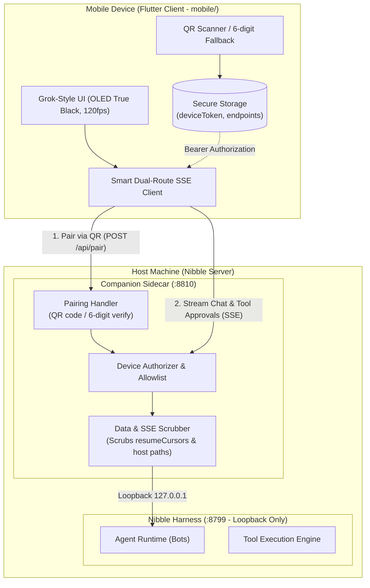

# Grok-Style Mobile Companion Design: Flutter Client for Nibble

- **Date:** 2026-11-16
- **Status:** Approved
- **Scope:** Architectural (New Mobile Application Project `mobile/`)

---

## 1. Problem Statement & Motivation

Nibble provides a desktop-centric experience with local AI agent teams. While the core harness restricts network binding to `127.0.0.1` for security (preventing DNS rebinding and host compromise), users need remote visibility, real-time streaming chat, and immediate tool approval capabilities from their smartphones.

### Goal
Build a standalone **Flutter Mobile Client** (`mobile/`) with a refined, high-contrast, minimalist **Grok-style design language** (OLED true black, pulsing avatar animations, fluid streaming, and haptic feedback) that communicates securely with Nibble via its dedicated **`companion` sidecar** (`:8810`).

---

## 2. System Architecture & Network Protocol

### Component Breakdown
1. **Companion Sidecar (`companion/`):**
   - Sits on `:8810` in front of the loopback-only harness (`127.0.0.1:8799`).
   - Handles device pairing (ephemeral 2-minute single-use QR secrets or 6-digit codes).
   - Issues persistent `deviceToken` hashed via SHA-256.
   - Scrubs sensitive internal parameters (`resumeCursors`, absolute host paths, SSH aliases) from all JSON and SSE responses before transmitting to the mobile client.
2. **Mobile Client (`mobile/`):**
   - Built with Flutter 3.x and Dart.
   - Employs Clean Architecture with Riverpod/BLoC state management.
   - Uses `flutter_secure_storage` (iOS Keychain, Android EncryptedSharedPreferences) to safeguard device tokens.
   - **Smart Dual-Route Switcher:**
     - Probes local LAN IP (`http://<lan-ip>:8810/healthz`) with 1.5s timeout.
     - Automatically falls back to Remote URL (Tailscale IP or Cloudflare Tunnel) when outside the home network.

---

## 3. UI/UX Design: Grok-Style Aesthetic

### 1. Visual Language & Typography
- **Palette:** Pure OLED Black background (`#000000`), Dark Charcoal surfaces (`#12151B`), Subtle Slate borders (`#1E222B`), and Crisp White text (`#F5F5F7`).
- **Living Mascot Animation:**
  - Bot avatar features a subtle breathing glow (*pulsing aura*) while thinking or executing tools.
  - Minimalist streaming text animation at 60–120fps.
- **Haptic Feedback:**
  - Micro-vibrations on message stream start, tool approval appearance, and button taps.

### 2. Core Screens & Components
- **Pairing View:**
  - High-performance QR scanner with tech-inspired alignment reticle and flash toggle.
  - Manual 6-digit code fallback input.
  - Multi-host switching (e.g., Home Desktop, Work PC).
- **Streaming Chat View:**
  - Message bubbles with comprehensive Markdown support (tables, lists, inline code).
  - Code syntax highlighting blocks with a one-tap "Copy" button.
  - Intelligent auto-scroll: sticks to bottom during live streaming only if the user is already at the bottom; preserves scroll position when reading history.
- **Interactive Tool Approval Cards:**
  - When an agent triggers a sensitive tool (e.g., `google__work__gmail_send_mail` or file system mutations), an interactive card surfaces in the chat thread.
  - Clearly displays tool name, human-readable argument summary, and danger level.
  - Two prominent action buttons:
    - **✓ Approve (Green):** Posts permission grant to companion.
    - **✕ Reject (Red):** Refuses tool call and resumes agent with rejection notice.

---

## 4. Resilience, Offline Caching & Error Handling

| Scenario | Client Behavior |
| :--- | :--- |
| **Network Switch (Wi-Fi to 4G/5G)** | Connection status indicator turns amber ("Reconnecting..."); automatically switches endpoints and retries with exponential backoff (1s, 2s, 4s, max 8s). |
| **Stream Interruption** | Reconnects with `Last-Event-ID` header; companion replays missing chunks without duplicating messages. |
| **Host Powered Off** | App presents cached conversation history (stored in SQLite/Hive) with a clean "Host Offline" status pill; queue outgoing messages until reconnection. |
| **Invalid/Revoked Token** | Returns to pairing screen with an explicit prompt to re-scan the desktop QR code. |

---

## 5. Security & Verification Invariants

1. **Zero Harness Exposure:**
   - The phone communicates exclusively with `companion` (:8810). The Nibble core harness remains strictly bound to `127.0.0.1`.
2. **Device Token Authorization:**
   - All mobile requests transmit `Authorization: Bearer <deviceToken>`.
3. **Isolated Test Fixtures:**
   - All client testing runs against an isolated mock companion fixture (`mobile/test/fixtures/fake-companion.ts`), ensuring zero reliance on live production bots or active user data (per `AGENTS.md` and `docs/verification/README.md`).

---

## 6. Implementation & Rollout Phases

### Phase 1: Scaffolding, Grok Theme & QR Pairing
- Initialize Flutter project under `mobile/` with `pubspec.yaml`, dependencies, and directory structure.
- Implement Grok OLED Dark Theme and living avatar pulse animations.
- Implement QR Scanner view, manual 6-digit entry, and Secure Storage persistence.

### Phase 2: Dual-Route SSE Network Client & Streaming Chat
- Implement `SseNetworkClient` with automatic LAN / Remote route fallback.
- Implement real-time streaming chat screen with Markdown and code syntax highlighting.
- Implement local message caching for offline reading.

### Phase 3: Interactive Tool Approval Cards & Verification
- Implement `ApprovalCard` widget with haptics and approve/reject endpoints.
- Build isolated Node.js fake companion test fixture (`mobile/test/fixtures/fake-companion.ts`).
- Automated Flutter unit and widget test suite.
- Android APK build script (`flutter build apk`).
